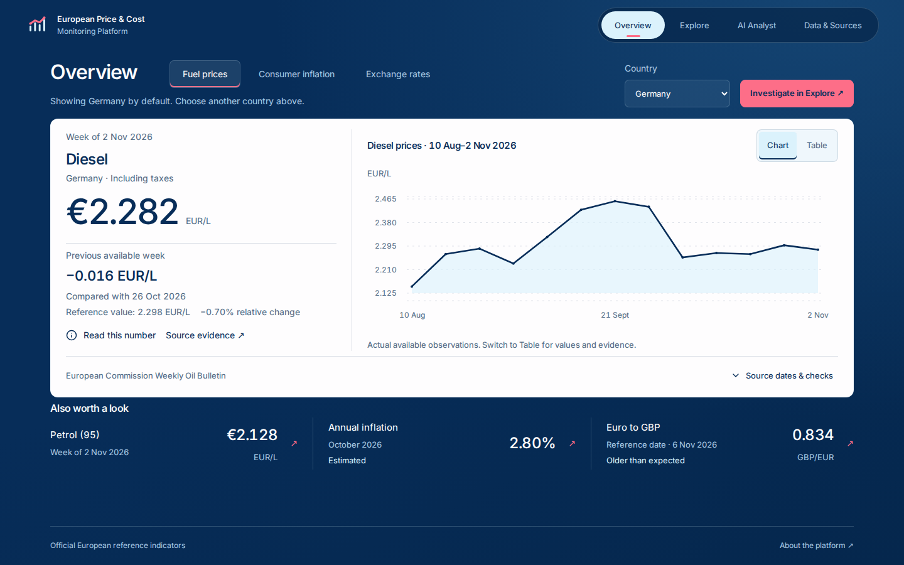
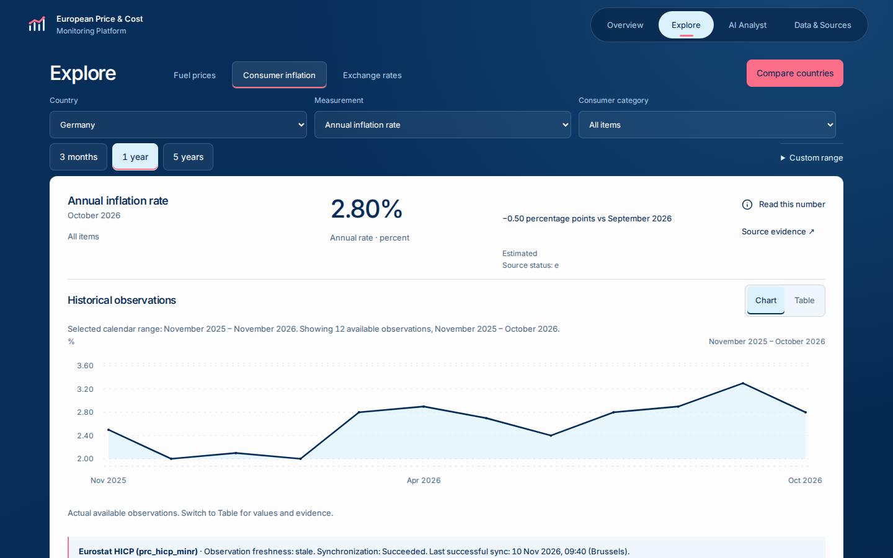
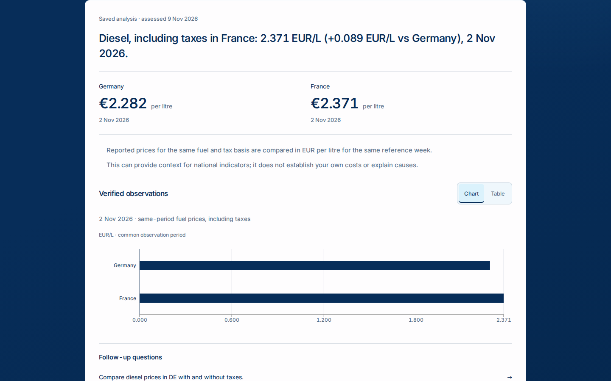
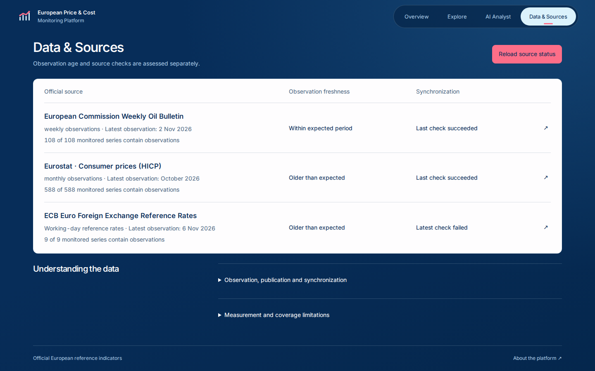
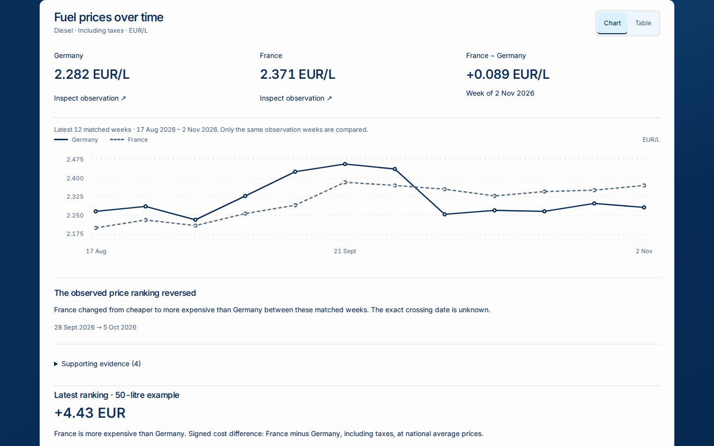
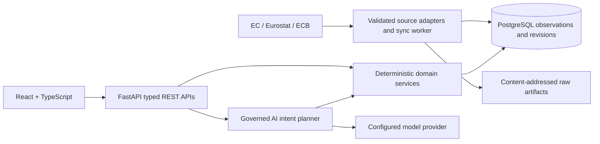

# European Price & Cost Monitoring Platform

Explore official European fuel prices, consumer inflation and euro exchange rates through clear charts, comparable observations and evidence-backed natural-language analysis.

A full-stack portfolio application built with React, FastAPI and PostgreSQL. The frontend presents a focused navy-and-white workspace; deterministic backend services handle numerical calculations, source semantics and provenance.


## What works today

- **Overview:** country-level fuel and inflation indicators, ECB reference rates, dated changes and historical trends.
- **Explore:** petrol/diesel, tax-inclusive/exclusive prices, HICP categories and annual/monthly/index measurements, EUR currency pairs and explicitly derived inverses. URL-based filters, chart/table alternatives and source evidence are supported.
- **Historical comparisons:** matched weekly fuel observations, country price gaps, ranking reversals and labelled 50-litre examples. Inflation-rate differences use percentage points; national index levels are not treated as comparable basket costs.
- **AI Analyst:** natural-language intent planning, clarification, approved domain operations, verified numerical results, follow-up questions and restorable analysis history.
- **Data & Sources:** actual stored coverage, observation freshness, synchronization health, quality annotations, publication/check dates and detailed provenance.
- **Synchronization:** official-source validation, historical backfill, incremental revision checks, transactional publication, source locking, raw-artifact hashes and an independent configurable scheduler.

No combined cost score, forecasts or unsupported explanations of economic causes are generated.

## Inside the application

### Overview



### Explore



### Governed AI analysis



The Analyst screenshot restores an actual successful saved analysis. Its assessment and observation dates are historical; restoration does not call the model again. All screenshots use real stored application data, not illustrative fixtures or a claim about today's prices.

### Data & Sources



<details>
<summary>Historical Germany–France fuel comparison</summary>



</details>

## Architecture



Source observations retain their periods, units, status flags and provenance. Backend Decimal calculations produce comparisons and contextual insights; the frontend formats verified values without replacing their underlying precision. Failed synchronization preserves the last successfully published dataset.

The price-cost Analyst uses constrained typed operations through these same services. It is **not an unrestricted SQL agent**. The preserved retail analyst separately retains its SQLGlot validation and bounded read-only database access; its tables, routes, migrations and historical records remain compatible without appearing in the current product navigation.

| Layer | Technology |
|---|---|
| Frontend | React 19, TypeScript, Vite, Inter, Recharts, Radix UI |
| Backend | Python 3.11, FastAPI, Pydantic, SQLAlchemy |
| Storage | PostgreSQL 16, Alembic, persistent raw-artifact volume |
| AI | Provider abstraction for Groq or Foundry Local; validated intent plans |
| Quality | Pytest, Vitest, Testing Library, Playwright, Axe, Ruff, ESLint |
| Runtime | Docker Compose, Nginx, independent synchronization worker |

## Official data sources

| Source | Measurements | Meaning |
|---|---|---|
| [European Commission Weekly Oil Bulletin](https://energy.ec.europa.eu/data-and-analysis/weekly-oil-bulletin_en) | Petrol (95) and diesel; both tax bases | National weekly averages normalized to EUR/L |
| [Eurostat HICP — `prc_hicp_minr`](https://ec.europa.eu/eurostat/databrowser/view/prc_hicp_minr/default/table) | Annual/monthly rates and 2025-based indices | Consumer-price changes and index levels, not prices in euros |
| [ECB exchange rates — EXR](https://data.ecb.europa.eu/data/datasets/EXR) | Working-day reference rates | Official direction: 1 EUR = X quote-currency units; inverses are labelled derived |

Coverage depends on configured series and successful imports. Missing observations remain missing. Publication dates, observation periods and synchronization timestamps are distinct. Fuel averages can differ from station prices; HICP is not an individual's cost basket; ECB reference rates are not guaranteed transaction quotes.

## Run locally with Docker

Requires Docker Engine/Desktop with Compose. For WSL, enable Docker Desktop's WSL integration. Internet access is needed to build images and retrieve official data. A model provider is optional for Overview, Explore and Sources.

```bash
git clone https://github.com/iayushmahajan/European-Retail-Intelligence-Platform.git
cd European-Retail-Intelligence-Platform
cp .env.example .env
```

Set **three distinct, URL-safe database passwords** in `.env`: `POSTGRES_PASSWORD`, `APP_DB_PASSWORD`, and `ANALYTICS_DB_PASSWORD`. Generate each with `openssl rand -hex 24`. Keep `.env` private. For an existing database, retain its existing passwords and take a backup before upgrades.

```bash
# Build the UI/API, initialize roles on a new volume, and apply compatible migrations.
docker compose up -d --build

# Initial official-data import, bounded to January 2025 onward.
docker compose --profile price-cost-sync run --build --rm --no-deps price-cost-sync \
  python -m app.scripts.sync_price_cost sync --mode backfill --since 2025-01-01

# Optional independent periodic checks.
docker compose --profile price-cost-sync up -d price-cost-sync
```

Open **http://localhost:5173**. API documentation: **http://localhost:5173/api/docs**. The five main routes are `/`, `/app/overview`, `/app/explore`, `/app/analyst` and `/app/sources`.

Browser requests pass through Nginx `/api` to the internal backend and PostgreSQL services; no host database or backend port is needed. On a fresh install the data pages remain empty until ingestion succeeds. Source failures are reported independently; use the [synchronization guide](docs/price-cost-synchronization.md) for retry, backfill and backup procedures.

```bash
# Read persisted synchronization status without importing data.
docker compose --profile price-cost-sync run --rm --no-deps price-cost-sync \
  python -m app.scripts.sync_price_cost status

# Stop safely; named database and artifact volumes remain intact.
docker compose --profile price-cost-sync stop
```

Never delete volumes to fix a deployment mismatch. See [WSL startup, development, backup and recovery](docs/price-cost-local-running.md) for full instructions. The optional Vite development workflow runs on port 4173 against the same Docker API.

## AI configuration and limits

Set `AI_PROVIDER`, `AI_MODEL`, `AI_API_URL` and, for a hosted provider, `AI_API_KEY` in `.env`. For example:

```dotenv
AI_PROVIDER=groq
AI_MODEL=openai/gpt-oss-20b
AI_API_URL=https://api.groq.com/openai/v1/chat/completions
AI_API_KEY=YOUR_PRIVATE_PROVIDER_KEY
```

Foundry Local is also supported; use its reported OpenAI-compatible endpoint and a model available on your machine. Recreate the backend after changing its environment. See the [Analyst guide](docs/price-cost-analyst.md) and [provider rate-limit notes](docs/price-cost-analyst-rate-limits.md).

The model primarily interprets intent. Typed plans, approved operations, bounded requests and deterministic calculations govern the result. Unsupported questions are blocked or clarified. Provider quotas, billing, availability and model quality can still prevent an answer; temporary throttling and exhausted quota are distinguished. No answer is fabricated when the provider fails. Questions are sent to the configured provider; avoid confidential input in this shared portfolio workspace.

## Validation

```bash
cd frontend
npm ci
npm run typecheck
npm run lint
npm test
npm run build
npx playwright install --with-deps chromium
npm run test:e2e
```

Frontend tests use deterministic, contract-compatible fixtures for success and failure scenarios. Live portfolio captures are separate and restore existing successful history without model calls: `npm run screenshots` (with the populated Docker application running).

Backend tests require Python dependencies from `backend/requirements-dev.txt`. PostgreSQL integration tests must use a **separate disposable database**, never the application database:

```bash
# Once, with Docker running: create only the explicitly disposable test database.
docker compose exec -T db createdb -U postgres -O analytics_app price_cost_m7_test
docker compose -f docker-compose.yml -f docker-compose.test.yml build backend-tests
docker compose -f docker-compose.yml -f docker-compose.test.yml run --rm --no-deps backend-tests
```

The tests intentionally reset that test database. If it already exists, reuse it. CI runs backend/frontend validation and container builds. See the [release verification record](docs/verification.md) for executed results, live checks and limitations.

## Documentation

- [Source contracts](docs/price-cost-source-contracts.md) · [Database architecture](docs/price-cost-database-architecture.md)
- [Synchronization and retention](docs/price-cost-synchronization.md) · [Local operations](docs/price-cost-local-running.md)
- [Price-cost APIs](docs/price-cost-api.md) · [Governed Analyst](docs/price-cost-analyst.md) · [Frontend architecture](docs/price-cost-frontend.md)

## Known limitations

This is a shared local portfolio application, not a hosted multi-tenant service. Authentication, tenant isolation and delivered alerts/reports are not implemented. Official series can be sparse, estimated, provisional, revised or temporarily unavailable. Synchronization health and observation freshness must both be inspected. HICP index-derived changes can differ slightly from published rates; cross-country index levels do not establish absolute cost-of-living differences.

History is bounded and paginated. Source coverage is not guaranteed to include every historical observation. Model access depends on external configuration and account limits. Automated accessibility checks complement, but do not replace, physical-device and screen-reader testing.

## Future development

Broader inflation-monitoring workflows and automated reporting are planned evolution, not additional capabilities claimed by this release. Any future work will build on the current source semantics, evidence and governed calculations rather than introduce unsupported forecasts or business-cost claims.
