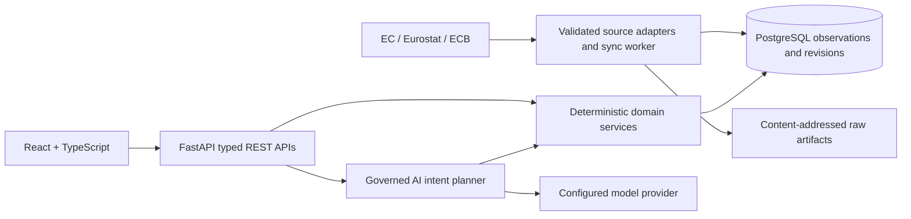

# European Price & Cost Monitoring Platform

I built this full-stack application to bring official European fuel prices, consumer inflation and euro exchange rates into one place. You can compare countries, follow historical changes and ask questions about the stored data.

The React and TypeScript frontend connects to a Python/FastAPI backend and PostgreSQL. The backend handles the calculations and keeps each observation linked to its source. For natural-language questions, the AI Analyst uses a model to select an approved operation, then runs it through those same services.


## Features

- **Overview** summarizes the latest available measurements for a selected country, with observation dates, historical trends and comparisons.
- **Explore** supports petrol and diesel prices with or without tax, HICP categories and measurements, and ECB euro reference rates. Filters are saved in the URL, and results can be viewed as charts or tables.
- **Country comparisons** align fuel prices by observation week and inflation rates by month. Fuel comparisons cover up to twelve matched weeks, including price gaps, changes in which country is cheaper and labelled 50-litre examples.
- **AI Analyst** answers supported fuel, inflation and currency questions, asks for clarification when needed and saves results with their evidence. Saved analyses can be reopened without another model call.
- **Data & Sources** shows stored coverage, source dates, quality flags and the distinction between old observations and a failed synchronization check.

An independent synchronization worker imports official data, checks for revisions and retains the original downloaded files. Scheduling is optional; manual backfill and incremental commands are also available.

## Inside the application

### Overview


### Explore


### Governed AI analysis


The screenshots use real stored observations, with the dates shown in the interface. The Analyst image is a saved successful analysis; reopening it does not call the model. These captures document the application at release, not today's prices.

### Data & Sources


<details>
<summary>Historical Germany–France fuel comparison</summary>


</details>

## Architecture



The source adapters validate official files and API responses before the synchronization worker writes them to PostgreSQL. Each observation retains its period, unit, source status and provenance. Revisions are recorded rather than discarded, and a failed import leaves the previous dataset available.

The API and Analyst share the same Decimal-based calculations. The model selects from typed operations; it cannot execute arbitrary SQL or calculate the final answer. The frontend formats the returned values for display and exposes exact values in evidence.

This project evolved from a retail analytics application. Its original routes and history remain available for compatibility, alongside a separate SQLGlot-validated retail analyst. The current price-cost Analyst uses backend services instead of generated SQL.

| Layer | Implementation |
|---|---|
| Frontend | React 19 and TypeScript, built with Vite; Recharts for charts, Radix UI for interactive controls and Inter typography |
| Backend | Python 3.11 and FastAPI; Pydantic validates API and intent contracts, SQLAlchemy handles database access |
| Storage | PostgreSQL 16 for observations and revisions, Alembic for migrations, a Docker volume for original source files |
| AI | A shared provider interface for Groq or Foundry Local, used to interpret analytical intent |
| Quality | Pytest, Vitest, Testing Library, Playwright, Axe, Ruff, ESLint |
| Runtime | Docker Compose runs the services; Nginx serves the frontend and proxies API requests |

## Official data sources

| Source | Measurements | Meaning |
|---|---|---|
| [European Commission Weekly Oil Bulletin](https://energy.ec.europa.eu/data-and-analysis/weekly-oil-bulletin_en) | Petrol (95) and diesel; both tax bases | National weekly averages normalized to EUR/L |
| [Eurostat HICP — `prc_hicp_minr`](https://ec.europa.eu/eurostat/databrowser/view/prc_hicp_minr/default/table) | Annual/monthly rates and 2025-based indices | Consumer-price changes and index levels, not prices in euros |
| [ECB exchange rates — EXR](https://data.ecb.europa.eu/data/datasets/EXR) | Working-day reference rates | Official direction: 1 EUR = X quote-currency units; inverses are labelled derived |

Coverage depends on configured series and successful imports. Missing observations remain missing. Publication dates, observation periods and synchronization timestamps are distinct. Fuel averages can differ from station prices; HICP is not an individual's cost basket; ECB reference rates are not guaranteed transaction quotes.

## Run locally with Docker

Requires Docker Engine/Desktop with Compose. For WSL, enable Docker Desktop's WSL integration. Internet access is needed to build images and retrieve official data. A model provider is optional for Overview, Explore and Sources.

```bash
git clone https://github.com/iayushmahajan/European-Retail-Intelligence-Platform.git
cd European-Retail-Intelligence-Platform
cp .env.example .env
```

Set **three distinct, URL-safe database passwords** in `.env`: `POSTGRES_PASSWORD`, `APP_DB_PASSWORD`, and `ANALYTICS_DB_PASSWORD`. Generate each with `openssl rand -hex 24`. Keep `.env` private. For an existing database, retain its existing passwords and take a backup before upgrades.

```bash
# Build the UI/API, initialize roles on a new volume, and apply compatible migrations.
docker compose up -d --build

# Initial official-data import, bounded to January 2025 onward.
docker compose --profile price-cost-sync run --build --rm --no-deps price-cost-sync \
  python -m app.scripts.sync_price_cost sync --mode backfill --since 2025-01-01

# Optional independent periodic checks.
docker compose --profile price-cost-sync up -d price-cost-sync
```

Open **http://localhost:5173**. API documentation: **http://localhost:5173/api/docs**. The five main routes are `/`, `/app/overview`, `/app/explore`, `/app/analyst` and `/app/sources`.

Browser requests pass through Nginx `/api` to the internal backend and PostgreSQL services; no host database or backend port is needed. On a fresh install the data pages remain empty until ingestion succeeds. Source failures are reported independently; use the [synchronization guide](docs/development.md#synchronization) for retry, backfill and backup procedures.

```bash
# Read persisted synchronization status without importing data.
docker compose --profile price-cost-sync run --rm --no-deps price-cost-sync \
  python -m app.scripts.sync_price_cost status

# Stop safely; named database and artifact volumes remain intact.
docker compose --profile price-cost-sync stop
```

Never delete volumes to fix a deployment mismatch. See [WSL startup, development, backup and recovery](docs/development.md) for full instructions. The optional Vite development workflow runs on port 4173 against the same Docker API.

## AI configuration and limits

Set `AI_PROVIDER`, `AI_MODEL`, `AI_API_URL` and, for a hosted provider, `AI_API_KEY` in `.env`. For example:

```dotenv
AI_PROVIDER=groq
AI_MODEL=openai/gpt-oss-20b
AI_API_URL=https://api.groq.com/openai/v1/chat/completions
AI_API_KEY=YOUR_PRIVATE_PROVIDER_KEY
```

For Foundry Local, use its reported OpenAI-compatible endpoint and an installed model. When the provider runs on the host and the backend runs in Docker, use `host.docker.internal` instead of `localhost` in `AI_API_URL`. After changing provider settings, run `docker compose up -d --force-recreate backend` to load the new environment. See the [Analyst guide](docs/ai-analyst.md) and [provider rate-limit notes](docs/ai-analyst.md#provider-rate-limits-and-recovery).

The Analyst supports a fixed set of operations and validates the model's plan before reading data. Unsupported requests receive a clarification or limitation message. Provider quotas, outages and invalid model output can still prevent an answer; the application reports those failures rather than substituting a prepared result.

Questions are sent to the configured provider. History is shared across this local application, so avoid confidential input. Temporary rate limits and exhausted quotas are handled differently; the Analyst reference explains retry behavior and account-level limits.

## Validation

For frontend development and tests, use Node.js 24 (the version used in CI) and npm.

```bash
cd frontend
npm ci
npm run typecheck
npm run lint
npm test
npm run build
npx playwright install --with-deps chromium
npm run test:e2e
```

Frontend tests use deterministic, contract-compatible fixtures for success and failure scenarios. Live portfolio captures are separate and restore existing successful history without model calls: `npm run screenshots` (with the populated Docker application running).

The backend test image installs `backend/requirements-dev.txt`. If running tests directly in Python, install those dependencies in a virtual environment. PostgreSQL integration tests must use a **separate disposable database**, never the application database:

```bash
# Return to the repository root after the frontend checks above.
cd ..
# Once, with Docker running: create only the explicitly disposable test database.
docker compose exec -T db createdb -U postgres -O analytics_app price_cost_m7_test
docker compose -f docker-compose.yml -f docker-compose.test.yml build backend-tests
docker compose -f docker-compose.yml -f docker-compose.test.yml run --rm --no-deps backend-tests
```

The tests intentionally reset that test database. If it already exists, reuse it. Run these Docker commands from the repository root. CI checks the backend, frontend and container builds. See [development](docs/development.md#tests-and-live-checks) for live checks and validation limits.

## Documentation

- [Architecture](docs/architecture.md): components, database design, frontend structure and security boundaries.
- [Data sources](docs/data-sources.md): official formats, measurement rules, ingestion, freshness and revisions.
- [API](docs/api.md): endpoint groups, pagination, comparisons and evidence; detailed schemas are in FastAPI's OpenAPI UI.
- [AI Analyst](docs/ai-analyst.md): approved operations, clarification, provider limits and saved results.
- [Development](docs/development.md): local setup, synchronization, tests, troubleshooting and recovery.

## Known limitations

This is a shared local portfolio application, not a hosted multi-tenant service. Authentication, tenant isolation and delivered alerts/reports are not implemented. Official series can be sparse, estimated, provisional, revised or temporarily unavailable. Synchronization health and observation freshness must both be inspected. HICP index-derived changes can differ slightly from published rates; cross-country index levels do not establish absolute cost-of-living differences.

History is bounded and paginated. Source coverage is not guaranteed to include every historical observation. Model access depends on external configuration and account limits. Automated accessibility checks complement, but do not replace, physical-device and screen-reader testing.

## Future development

Planned work includes broader inflation-monitoring workflows and automated reporting. The current application already displays HICP data, but it does not deliver scheduled reports or alerts.
