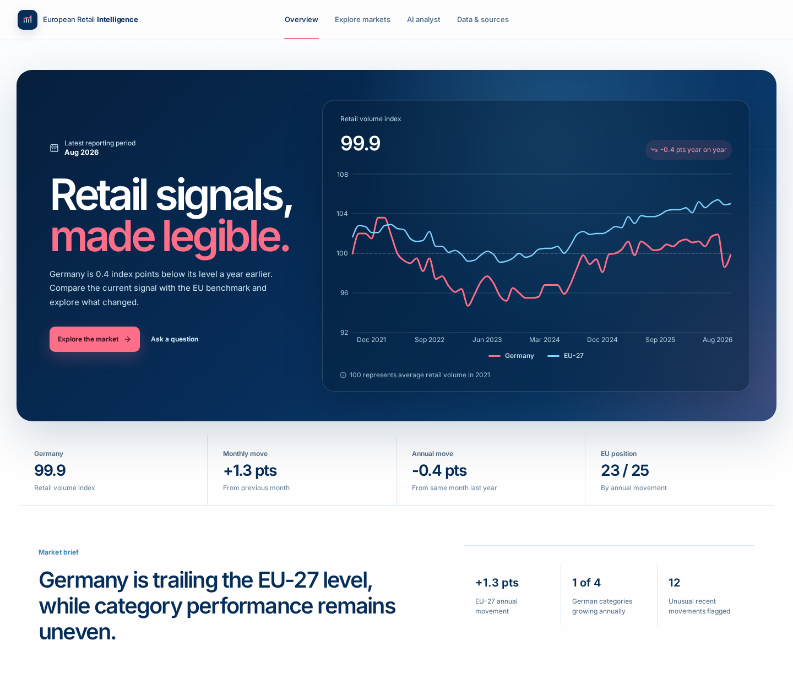
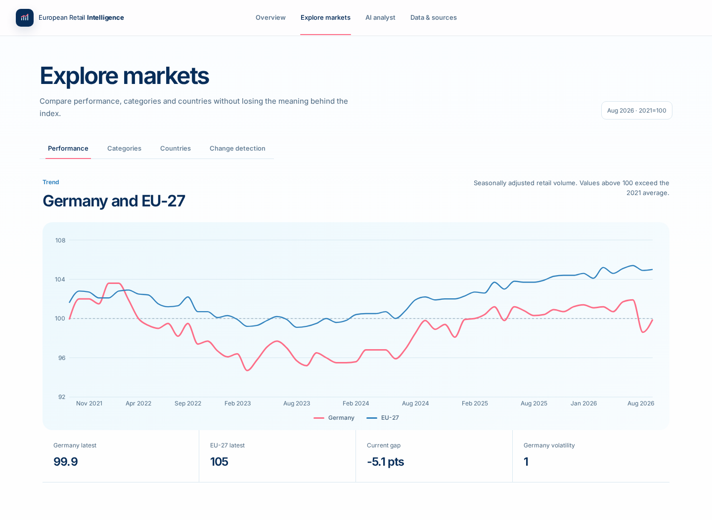
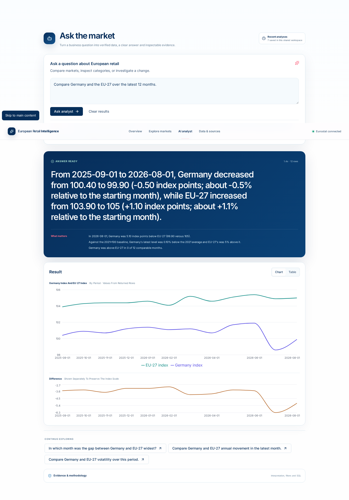
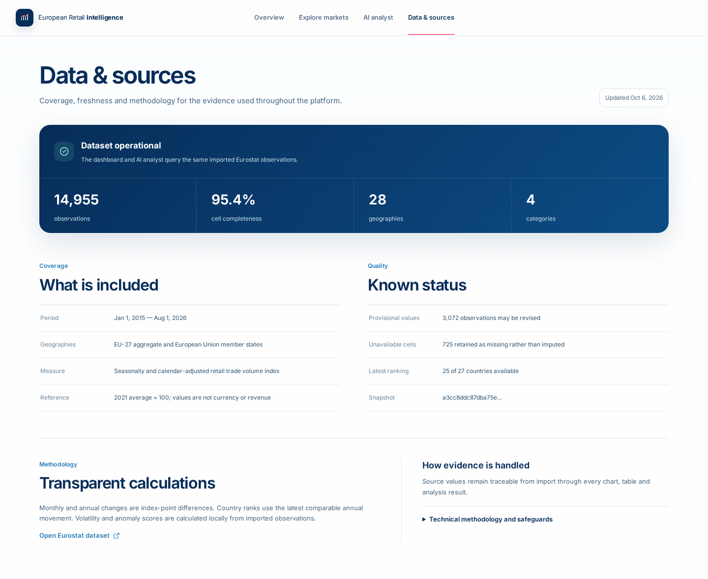
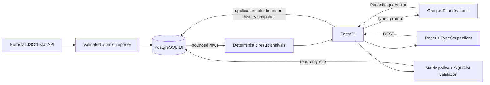

# European Retail Intelligence Platform

A governed analytics application for people who need to understand European retail activity without writing SQL. It combines an interactive market workspace with natural-language analysis over one official dataset: Eurostat's monthly retail trade volume index (`sts_trtu_m`).

The project is designed around an important constraint: an AI-generated query is never trusted as executable SQL. The model must produce a typed query plan; the backend checks the requested metric and SQL structure, runs the statement through a least-privilege PostgreSQL role, bounds the result, and exposes the evidence to the user.

## The problem it solves

Official market data is credible but difficult for non-technical stakeholders to navigate. Definitions, units, missing observations and revisions matter, while an ordinary text-to-SQL interface can hide mistakes or execute unsafe statements.

This application provides:

- a concise overview of Germany against the EU-27 benchmark;
- focused exploration of performance, categories, country rankings and unusual movements;
- natural-language questions with clarification when the scope is ambiguous;
- deterministic findings, charts, tables, CSV export and restorable analysis history;
- visible metric definitions, filters, source tables and validated SQL; and
- data coverage, freshness, quality, provenance and methodology in the product itself.

## Finished interface

### Overview



The entry workspace presents the latest Germany and EU-27 signals, their difference and the recent market trend.

### Explore Markets



Performance, retail categories, country benchmarks and change detection are separated into focused views with explicit units and baselines.

### AI Analyst



The analyst leads with a concise answer and calculated findings. The full explanation, assumptions, methodology and validated SQL remain available as evidence.

### Data & Sources



Coverage, freshness, quality, provenance and technical methodology are kept together for non-technical review and deeper inspection.

## Architecture and data flow



For a natural-language request:

1. FastAPI supplies the model with the supported schema, metric catalogue and analytical rules.
2. The provider returns a typed `ready`, `needs_clarification` or `blocked` plan.
3. Pydantic validates the contract; the metric policy checks the declared source and required filters.
4. SQLGlot parses the statement and rejects writes, multiple statements, unknown objects and unsafe constructs.
5. A separate PostgreSQL reader role executes the query in a read-only transaction with time, row and byte limits.
6. Deterministic code interprets the validated rows, including aligned country comparisons.
7. The client renders the answer, evidence, chart/table, export and restorable bounded snapshot.

Overview and exploration endpoints use deterministic SQL and do not require an AI provider.

## Data and analytical meaning

The curated dataset covers the EU-27 aggregate and all 27 member states from January 2015 onward for four categories:

- total retail;
- food, beverages and tobacco;
- non-food excluding automotive fuel; and
- automotive fuel.

All observations use Eurostat's seasonally and calendar-adjusted volume index with `2021=100`. Values measure sales volume, not money. A level of `105` means estimated retail volume is 5% above its average 2021 level. Moving from `103.9` to `105.0` is an increase of 1.1 index points, or approximately 1.1% relative to the starting value (`1.1 / 103.9`).

The importer derives monthly and annual change, rolling volatility and a robust anomaly score from each series. An anomaly flag identifies an unusual movement relative to up to 36 preceding monthly changes; it does not claim a cause. Missing source observations remain missing rather than being imputed.

The analyst cannot answer questions about revenue, customers, products, profit, prices or individual companies because those fields do not exist in this dataset.

## Security boundaries

The application uses layered controls rather than relying on prompt instructions alone:

- strict Pydantic plans gate clarification, blocked and executable responses;
- the metric catalogue ties business definitions to permitted source fields;
- SQLGlot enforces one read-only query, allowlisted relations/functions and a static row cap;
- `analytics_reader` has no write, DDL or history-table privileges;
- every execution uses a read-only transaction, restricted search path and statement timeout;
- returned rows, columns, bytes and result-analysis context are bounded; and
- the UI exposes SQL and assumptions because safety checks cannot prove semantic correctness.

User questions are sent to the configured AI provider. The demo is a shared workspace, so users should not enter personal or confidential information.

## Technology stack

| Area | Technology |
| --- | --- |
| Frontend | React 19, TypeScript, Vite, Tailwind CSS, selected shadcn/ui-style primitives, Recharts |
| API | FastAPI, Pydantic, SQLAlchemy |
| Data | PostgreSQL 16, Alembic, Eurostat JSON-stat API |
| AI providers | Groq or Microsoft Foundry Local through OpenAI-compatible chat completions |
| Query controls | SQLGlot, metric catalogue, allowlisted schema, read-only role, execution bounds |
| Quality | Pytest, Vitest, Testing Library, Playwright, Axe, Ruff, ESLint |
| Runtime | Docker Compose and Nginx |

## Repository structure

```text
backend/
  app/api/          FastAPI routes and response contracts
  app/services/     provider, policy, SQL validation/execution and analysis
  app/scripts/      Eurostat import, grants and maintenance commands
  alembic/          database migrations
  tests/            unit, API and isolated PostgreSQL integration tests
database/           first-volume PostgreSQL role initialization
frontend/
  src/components/   reusable shell, UI, charts and analyst components
  src/pages/        four routed workspaces
  src/services/     typed API client
  tests/            component and browser workflows
docs/screenshots/   deterministic portfolio screenshots
.github/workflows/  backend and frontend CI
```

## Run with Docker Compose

Prerequisites: Docker Desktop/Engine with Compose, internet access for the Eurostat import, and optionally a Groq key or a running Foundry Local server for AI Analyst.

Copy the environment template and generate **three different** database passwords:

```bash
cp .env.example .env
openssl rand -hex 24  # POSTGRES_PASSWORD
openssl rand -hex 24  # APP_DB_PASSWORD
openssl rand -hex 24  # ANALYTICS_DB_PASSWORD
```

Place the values in `.env`; do not commit that file. Start the services, then import Eurostat:

```bash
docker compose up --build -d
docker compose --profile eurostat-data run --build --rm eurostat-data
docker compose ps
```

Open <http://localhost:5173>. API documentation is available at <http://localhost:5173/api/docs>.

Database roles are created only when PostgreSQL initializes an empty volume. If you change database passwords after the first start, update the roles manually or, for a disposable local demo only, recreate the volume:

```bash
# Destructive: deletes the local database and saved analysis history.
docker compose down -v
docker compose up --build -d
docker compose --profile eurostat-data run --build --rm eurostat-data
```

Re-run the import command to fetch a newer Eurostat snapshot. The importer validates dimensions, countries, categories, values and response size before replacing observations in one transaction. For reproducibility, it can also import a downloaded response with `--payload` and verify `--expected-sha256`.

## Configure AI Analyst

The other three workspaces run without an AI provider. Natural-language analysis requires one of these OpenAI-compatible configurations.

### Groq

```dotenv
AI_PROVIDER=groq
AI_MODEL=openai/gpt-oss-20b
AI_API_URL=https://api.groq.com/openai/v1/chat/completions
AI_API_KEY=your_groq_key
AI_REQUEST_TIMEOUT_SECONDS=120
```

Groq's free tier has account-specific rate and usage limits that can change. Treat the key as a secret and rotate any key pasted into chat, logs or source control.

### Microsoft Foundry Local

Start the server and load Phi-4 Mini:

```bash
foundry --version
foundry server start --idle-timeout 0
foundry model load phi-4-mini
foundry server status
```

The port is dynamic. Use the URL reported by `foundry server status`; for Docker Desktop, replace `127.0.0.1` with `host.docker.internal`:

```dotenv
AI_PROVIDER=foundry_local
AI_MODEL=phi-4-mini
AI_API_URL=http://host.docker.internal:PORT/v1/chat/completions
AI_API_KEY=
AI_REQUEST_TIMEOUT_SECONDS=120
```

Local inference has no per-request API charge but can be slow and memory intensive on CPU. Groq is generally faster and lighter on the laptop. After changing provider settings, recreate the relevant services:

```bash
docker compose up --build -d backend frontend
docker compose logs -f backend
```

## Price and cost monitoring development

The `feature/price-cost-monitoring` branch adds official fuel, HICP and ECB data
alongside the existing retail application. See the
[database architecture](docs/price-cost-database-architecture.md) and
[synchronization operations guide](docs/price-cost-synchronization.md) for source
mappings, historical backfill, incremental checks, CLI commands, the optional
Docker scheduler, provenance, revision handling and artifact backup.
The [API v1 guide](docs/price-cost-api.md) documents typed price/cost endpoints,
comparison rules, deterministic explanations, freshness and provenance.
The [governed analyst guide](docs/price-cost-analyst.md) covers natural-language
price/cost questions, typed operations, evidence and versioned result restoration.

## Development and validation

Backend unit/API tests use isolated in-memory SQLite and mock providers. PostgreSQL integration tests require explicitly disposable test URLs and `TEST_ALLOW_RESET=1`; CI provisions this environment automatically.

Python virtual-environment launchers contain absolute paths. If you move or rename an existing checkout, recreate `backend/.venv` before using its console commands; Docker-based development is unaffected.

```bash
cd backend
python -m venv .venv
source .venv/bin/activate
pip install -r requirements-dev.txt
ruff check .
pytest -q -m "not integration"
```

```bash
cd frontend
npm ci
npm test
npm run lint
npm run typecheck
npm run build
npm run test:e2e
npm audit --omit=dev
```

With the application running and seeded with a successful analysis, regenerate stable screenshots with:

```bash
cd frontend
npm run screenshots
```

CI runs the complete backend suite against PostgreSQL 16, both container builds, frontend component tests, linting, type checking, the production build and Playwright workflows. See [the verification record](docs/verification.md) for the latest local results.

## A concise demonstration path

1. **Overview:** explain `2021=100`, the latest Germany/EU-27 difference and the common time series.
2. **Explore Markets:** switch category and country views; show that anomalies and missing coverage are explicit.
3. **AI Analyst:** ask “Compare Germany and the EU-27 over the latest 12 months.” Highlight the concise finding, aligned chart/table and follow-up actions.
4. **Evidence:** expand assumptions and SQL; explain typed plans, SQLGlot and the read-only database role.
5. **Data & Sources:** close with Eurostat provenance, freshness, coverage and methodology.

## Scope and limitations

This is a portfolio analytics application, not a production multi-tenant BI service. It has shared history and no authentication, scheduled ingestion, alert delivery, observability stack or deployment infrastructure. Eurostat values may be missing, provisional or revised. AI-generated queries can be technically safe yet semantically imperfect, which is why evidence remains inspectable. The manually mirrored frontend API types could drift from backend contracts without tests.

Forecasting is intentionally not implemented. An earlier model did not consistently beat transparent baselines, and a national retail index is not a defensible company-demand target. A future forecast would require a specific decision, target, evaluation window and baseline—not another dashboard card.

Possible future expansion is deliberately separated from implemented functionality: authentication and tenant isolation, scheduled imports, production observability, generated OpenAPI client types and a defensible forecasting use case. None of these are claimed as current features.

Source: [Eurostat monthly retail trade volume index (`sts_trtu_m`)](https://ec.europa.eu/eurostat/databrowser/view/sts_trtu_m/default/table).
