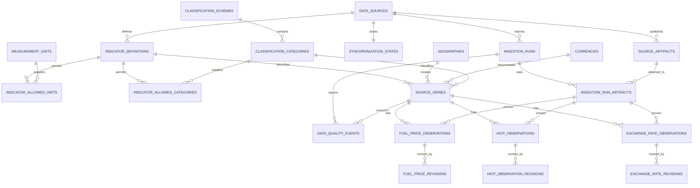

# Architecture

The application has three main runtime components: a React/TypeScript frontend,
a FastAPI backend and PostgreSQL. An independent worker imports official data.
The [README diagram](../README.md#architecture) shows the request and import paths.

| Component | Responsibility and implementation |
| --- | --- |
| Frontend | Routes, URL-based selections and presentation under `frontend/src/price-cost/` |
| Read API | Thin routes in `backend/app/api/routes/price_cost.py`; fixed SQLAlchemy reads and Decimal calculations in `backend/app/services/price_cost/` |
| AI Analyst | Intent validation, approved service dispatch and saved evidence in `backend/app/services/price_cost_analyst/` |
| Ingestion | Source adapters under `backend/app/data_sources/`, publication and revisions under `backend/app/ingestion/`, CLI/scheduler in `backend/app/scripts/sync_price_cost.py` |
| Storage | PostgreSQL observations and revision tables; the `price_cost_raw` volume retains original responses |

Migration `0008` adds the price-cost schema alongside the original retail tables.
The catalogue defines compatible series; separate observation tables enforce the
units and periods that differ between fuel, inflation and exchange rates.
[Data sources](data-sources.md) explains their contracts and publication rules.

## Entity relationships

## Shared catalogue

### `data_sources`

Stable source identifiers, official URLs, reuse-policy URLs, descriptions, and
expected frequencies. Migration `0008` seeds only the three approved sources:

- `ec_weekly_oil_bulletin`
- `eurostat_prc_hicp_minr`
- `ecb_exr`

### `geographies` and `currencies`

`geographies` contains the EU-27 aggregate and 27 member countries. It keeps a
stable internal/source-facing code, ISO alpha-2 where applicable, region
membership, current currency, and JSONB source-code metadata. Greece retains
Eurostat code `EL` and ISO code `GR` as separate facts.

`currencies` contains EUR and the initial ECB quote currencies. Currency codes
must be uppercase three-character identifiers.

### Indicators, units, and classifications

`indicator_definitions` records the source, frequency, series kind, measurement
type, and reference base. `measurement_units` records explicit units rather
than treating all numbers as interchangeable.

The initial units are:

- `EUR_PER_1000_LITRES` for raw Oil Bulletin values.
- `EUR_PER_LITRE` for normalized fuel prices.
- `INDEX_2025_100` for HICP index levels.
- `PERCENT` for published monthly and annual HICP rates.
- `FOREIGN_CURRENCY_PER_EUR` for the official ECB quote direction.

`classification_schemes` and `classification_categories` contain the two fuel
products and selected ECOICOP 2018 categories. The
`indicator_allowed_units` and `indicator_allowed_categories` junctions form an
explicit allowlist. A source series cannot combine, for example, an HICP annual
rate with a fuel category or an index indicator with a percentage unit.

### `source_series`

A series is the stable dimensional identity shared by observations:

- Fuel: source + country + product + tax basis.
- HICP: source + geography + ECOICOP category + measurement type.
- ECB: source + EUR base currency + quote currency.

Composite foreign keys bind a series to its declared indicator contract,
allowed unit, and allowed category. Partial unique indexes reject duplicate
semantic series even when different external keys are supplied. JSONB
`source_dimensions` preserves source-native identifiers without driving core
relational logic.

## Observation tables

### `fuel_price_observations`

One row per source series and reference week.

- Raw value: `NUMERIC(30,15)` in `EUR_PER_1000_LITRES`.
- Normalized value: `NUMERIC(30,18)` in EUR/litre.
- A check constraint enforces `normalized = raw / 1000`.
- Publication date is nullable but cannot precede the reference week.
- Product, country, tax basis, normalized unit, and frequency are fixed by the
  referenced series.

### `hicp_observations`

One row per source series and reference month.

- Reference dates must be the first day of the represented month.
- Index observations require base year 2025 and a positive value.
- Monthly and annual percentage rates have no index base and may be negative.
- Eurostat statuses such as estimated or provisional remain nullable text and
  are stored unchanged.
- Missing source coordinates have no observation row; they are never inserted
  as zero.

### `exchange_rate_observations`

One row per source series and ECB reference date.

- Rate: `NUMERIC(30,15)`.
- Base must be EUR and must match the series.
- Quote convention is fixed to `FOREIGN_CURRENCY_PER_EUR`.
- Source precision, status, and confidentiality are retained.
- No database constraint demands calendar-day or weekday continuity. Weekends,
  TARGET closing days, and other absent publications therefore do not create
  synthetic observations or automatic quality failures.

Fuel weeks, HICP months and ECB reference dates remain separate. The application
does not automatically align them or combine them into an overall cost score.

## Ingestion and provenance

### Runs and artifacts

`ingestion_runs` stores execution status, trigger, adapter version, timestamps,
source update time, counts, and sanitized failure summaries.

`source_artifacts` stores the official URL, exact lowercase SHA-256, byte size,
content type, retrieval/publication timestamps, covered period, optional local
storage path, and bounded source metadata. Raw workbooks and API payloads live in the artifact volume; the database stores
their metadata.

`ingestion_run_artifacts` is a source-consistent many-to-many link. Each current
observation references a valid run/artifact/source tuple, preventing an ECB
artifact from becoming provenance for an Oil Bulletin observation.

### Raw artifacts

Original responses are stored outside PostgreSQL at
`raw/{source_code}/{sha256}.{extension}`. The database holds hashes and provenance
links. See [retention, backup and recovery](development.md#raw-storage-backup-and-recovery)
for the rules that keep current and revised observations auditable.

### Synchronization and quality

`synchronization_states` stores last attempt/success, last run, HTTP validators,
a JSONB cursor, failure count and freshness state. The ingestion service and
scheduler use this state to decide what to fetch next. Ordinary API requests
do not trigger synchronization.

`data_quality_events` stores explicit, source-scoped informational, warning, or
error events. A missing HICP cell can be recorded with reference-period details
without inventing an observation. Expected ECB calendar gaps require no event
unless an ingestion policy explicitly determines that a publication was due.

## Revision strategy

Current observation tables contain the latest verified value and its current
run/artifact provenance. Before a changed value is applied, the synchronizer:

1. Compares the incoming typed record with the current row.
2. Inserts a source-specific revision row containing previous and replacement
   values/status fields.
3. References both the superseded and replacement run/artifact pairs.
4. Updates the current observation in the same transaction.

Separate `fuel_price_revisions`, `hicp_observation_revisions`, and
`exchange_rate_revisions` avoid ambiguous JSON value histories and retain the
correct decimal precision and source attributes for each domain.

Keeping current values in dedicated tables makes ordinary reads straightforward.
The revision tables preserve previous values, but the application does not provide
a complete historical database snapshot for an arbitrary past time. That would
require reconstructing changes beyond the current observation rows.

## Indexes and integrity

- Unique `(series_id, reference period)` constraints define every fact grain.
- Source/external series keys and semantic series dimensions are unique.
- Date/series indexes support recent-period and time-series access.
- Source/run and source/artifact indexes support freshness and operational
  inspection.
- Revision indexes support audit lookup by current observation.
- Composite foreign keys keep source, series, run, and artifact provenance
  consistent.
- PostgreSQL JSONB checks require metadata documents to be objects.
- SHA-256 values must be exactly 64 lowercase hexadecimal characters.

## Security boundary

The price-cost tables are owned by `analytics_app`. The existing grants script first
revokes every table and sequence privilege from `analytics_reader`, then grants
only the existing retail tables. Consequently the AI/query role cannot select
or modify catalogue, provenance, observation, quality, or revision tables.

Application services use fixed queries over typed observations. The price-cost
Analyst invokes these services rather than AI-facing SQL views; any future
AI-readable view would require an explicit allowlist and `SELECT` grant.

## Service boundaries

Analytical requests use the application role in **REPEATABLE READ, READ ONLY**
transactions, with 5-second statement and 1-second lock timeouts. Administrative
roles are rejected. The application role still owns write privileges used by
migrations, ingestion and history outside those read-only transactions; it is not
a separately provisioned least-privilege reader. Only the legacy retail SQL path
uses `analytics_reader`, whose grants remain restricted to retail tables.

The repository uses bound SQLAlchemy selections and indexed latest/previous
lookups. History reads are bounded and paginated, not silently downsampled.
Repeatable-read snapshots keep metric and evidence composition consistent during
concurrent ingestion; there is no application cache hiding newly committed data.

The [Analyst](ai-analyst.md) invokes these same services with validated operations,
then saves versioned results and frozen evidence in the existing query-history
JSON snapshot. Its history write is separate from analytical reads. It does not
add model-generated SQL, analytical views or AI reader grants.

## Frontend

### Routes and components

| Route | Purpose |
|---|---|
| `/` | Concise introduction and entry into the workspace |
| `/app/overview` | Latest dated measurements, trends, contextual supporting indicators and source disclosure |
| `/app/explore` | Validated URL filters, all three domains, history pagination, comparisons and chart/table alternatives |
| `/app/analyst` | Governed question composer, clarification, typed results, evidence and saved history |
| `/app/sources` | Coverage, observation freshness, synchronization health, methodology and publication/check details |

Paths in this document are relative to `frontend/`. `src/price-cost/components/Shell.tsx` handles application navigation, route focus and the footer. Page components and their CSS stay under `src/price-cost/`. The API client in `api.ts` uses the `/api` base URL; `contracts.ts` contains types generated from the backend OpenAPI schema. `useResource` aborts superseded requests and ignores stale responses so an older selection cannot overwrite a newer one.

`OverviewMetric`, `History`, `CountryComparison`, `FuelComparisonHistory`, `AnalystResult` and the shared evidence/insight panels compose the analytical interfaces. Legacy retail routes (`/overview`, `/explore`, `/analyst`, `/data`) and their stored history remain accessible directly for compatibility. They are intentionally absent from the current product navigation.

### Numerical and date semantics

`format.ts` centralizes display formatting. Rates, percentage-point differences and index levels generally use two decimals; fuel and FX quotes use three where meaningful. Smaller nonzero changes use explicit precision to avoid misleading zeroes. Exact source strings remain in evidence; only finite chart coordinates are converted to numbers. The frontend never recomputes economic comparisons from rounded display values.

Fuel prices use EUR/L and explicit tax bases. HICP rates are percentages, changes between rates are percentage points, and index levels retain their base. National index levels are not comparable basket prices. FX uses the official EUR base or an explicitly selected backend-derived inverse consistently through figures, charts, tables and insights. Old inverse snapshots without comparison metadata show unavailable comparisons rather than official-direction changes.

Observation periods, publication dates, successful synchronization, latest check and assessment dates remain separate. Source quality/status flags and failed-check warnings are retained.

### History and comparison behavior

Explore requests the newest bounded history page in the selected calendar range (`order=desc`, 260 observations). Its last chronological record supplies the headline. Older records prepend through `previous_end`, preserving the start boundary and 2,000-record client cap. Empty ranges do not fall back to older headlines. Actual count/span is labelled separately from the calendar range.

Overview inflation presents the latest twelve available monthly observations anchored to the inspected measurement, not invented missing months. Annual inflation compares prices with the same month a year earlier; monthly inflation compares the preceding month. A lazy matching-index disclosure uses compatible same-country/category/base observations and labels missing cells.

Fuel country comparison uses up to twelve actual matched weeks, one product and tax basis. Lines break across gaps. Latest prices and signed differences are separate from period averages. Observed ranking reversals identify weeks, never an invented crossing date. Inflation comparison shows the reference once, with chart/table alternatives for peers' signed percentage-point differences.

### Context and evidence

The “Read this number” drawer identifies the selected geography, measurement, unit, period and tax basis. It presents at most two backend-calculated insights: labelled fuel-purchase changes, compatible HICP price-level context and optional same-month EU-27 rates, or selected-direction currency conversion changes. Evidence links retain original precision and source annotations; longer lists use disclosures.

Exact values, methodology/provenance and revisions stay accessible in the shared evidence drawer. Unknown publication dates remain unknown. No LLM generates contextual numerical claims.

### Analyst states and compatibility

The client supports success, clarification, unavailable, blocked and failed outcomes. Clarification preserves the original question/history; cancellation and provider cooldown prevent stale or repeated submissions. A saved result restores through GET history endpoints without calling the provider. Dataset/schema version, assessment date, provenance and original backend answers remain inspectable.

The prominent answer is formatted from typed result fields. The frontend does not rewrite arbitrary numbers in prose. Provider failures and quota messages are shown separately from analytical results.

### Accessibility and development

Shared components retain keyboard focus, chart/table alternatives, mobile touch
targets and reduced-motion support. Expanded details, long tables and smaller
screens scroll naturally rather than clipping content to fit a viewport.
See [development](development.md) for commands and validation limits.
