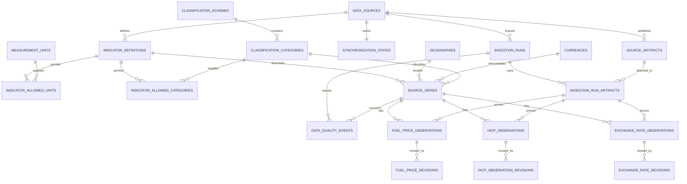

# Price and cost database architecture — Milestones 2–5

Milestone 2 adds a PostgreSQL foundation for the European Price & Cost
Monitoring Platform without removing or changing the existing retail schema.
Migration `0008` creates a shared catalogue, three typed observation tables,
and provenance/revision infrastructure. It does not expose new data to the AI
reader or change any API.

## Entity relationships



## Shared catalogue

### `data_sources`

Stable source identifiers, official URLs, reuse-policy URLs, descriptions, and
expected frequencies. Migration `0008` seeds only the three approved sources:

- `ec_weekly_oil_bulletin`
- `eurostat_prc_hicp_minr`
- `ecb_exr`

### `geographies` and `currencies`

`geographies` contains the EU-27 aggregate and 27 member countries. It keeps a
stable internal/source-facing code, ISO alpha-2 where applicable, region
membership, current currency, and JSONB source-code metadata. Greece retains
Eurostat code `EL` and ISO code `GR` as separate facts.

`currencies` contains EUR and the initial ECB quote currencies. Currency codes
must be uppercase three-character identifiers.

### Indicators, units, and classifications

`indicator_definitions` records the source, frequency, series kind, measurement
type, and reference base. `measurement_units` records explicit units rather
than treating all numbers as interchangeable.

The initial units are:

- `EUR_PER_1000_LITRES` for raw Oil Bulletin values.
- `EUR_PER_LITRE` for normalized fuel prices.
- `INDEX_2025_100` for HICP index levels.
- `PERCENT` for published monthly and annual HICP rates.
- `FOREIGN_CURRENCY_PER_EUR` for the official ECB quote direction.

`classification_schemes` and `classification_categories` contain the two fuel
products and selected ECOICOP 2018 categories. The
`indicator_allowed_units` and `indicator_allowed_categories` junctions form an
explicit allowlist. A source series cannot combine, for example, an HICP annual
rate with a fuel category or an index indicator with a percentage unit.

### `source_series`

A series is the stable dimensional identity shared by observations:

- Fuel: source + country + product + tax basis.
- HICP: source + geography + ECOICOP category + measurement type.
- ECB: source + EUR base currency + quote currency.

Composite foreign keys bind a series to its declared indicator contract,
allowed unit, and allowed category. Partial unique indexes reject duplicate
semantic series even when different external keys are supplied. JSONB
`source_dimensions` preserves source-native identifiers without driving core
relational logic.

## Typed observation grains

### `fuel_price_observations`

One row per source series and reference week.

- Raw value: `NUMERIC(30,15)` in `EUR_PER_1000_LITRES`.
- Normalized value: `NUMERIC(30,18)` in EUR/litre.
- A check constraint enforces `normalized = raw / 1000`.
- Publication date is nullable but cannot precede the reference week.
- Product, country, tax basis, normalized unit, and frequency are fixed by the
  referenced series.

### `hicp_observations`

One row per source series and reference month.

- Reference dates must be the first day of the represented month.
- Index observations require base year 2025 and a positive value.
- Monthly and annual percentage rates have no index base and may be negative.
- Eurostat statuses such as estimated or provisional remain nullable text and
  are stored unchanged.
- Missing source coordinates have no observation row; they are never inserted
  as zero.

### `exchange_rate_observations`

One row per source series and ECB reference date.

- Rate: `NUMERIC(30,15)`.
- Base must be EUR and must match the series.
- Quote convention is fixed to `FOREIGN_CURRENCY_PER_EUR`.
- Source precision, status, and confidentiality are retained.
- No database constraint demands calendar-day or weekday continuity. Weekends,
  TARGET closing days, and other absent publications therefore do not create
  synthetic observations or automatic quality failures.

No table aligns daily, weekly, or monthly observations automatically. Such an
operation must be an explicitly defined analytical calculation later.

## Ingestion and provenance

### Runs and artifacts

`ingestion_runs` stores execution status, trigger, adapter version, timestamps,
source update time, counts, and sanitized failure summaries.

`source_artifacts` stores the official URL, exact lowercase SHA-256, byte size,
content type, retrieval/publication timestamps, covered period, optional local
storage path, and bounded source metadata. The database stores metadata—not
raw workbooks or API payloads.

`ingestion_run_artifacts` is a source-consistent many-to-many link. Each current
observation references a valid run/artifact/source tuple, preventing an ECB
artifact from becoming provenance for an Oil Bulletin observation.

### Raw-artifact retention policy

Milestone 3 writes validated raw responses to a content-addressed local
Docker volume such as:

```text
raw/{source_code}/{sha256}.{extension}
```

All artifacts referenced by successful observations or revisions should be
retained. Failed/unreferenced downloads may be removed after 30 days. The
database keeps hashes and metadata permanently. This is practical for the
current project and avoids introducing object storage prematurely.

### Synchronization and quality

`synchronization_states` stores last attempt/success, last run, HTTP validators,
a JSONB cursor, failure count, and freshness state. The Milestone 3 orchestrator and independent Docker worker use this state;
ordinary API requests do not trigger synchronization.

`data_quality_events` stores explicit, source-scoped informational, warning, or
error events. A missing HICP cell can be recorded with reference-period details
without inventing an observation. Expected ECB calendar gaps require no event
unless an ingestion policy explicitly determines that a publication was due.

## Revision strategy

Current observation tables contain the latest verified value and its current
run/artifact provenance. Before a changed value is applied, the synchronizer:

1. Compare the incoming typed record with the current row.
2. Insert a source-specific revision row containing previous and replacement
   values/status fields.
3. Reference both the superseded and replacement run/artifact pairs.
4. Update the current observation in the same transaction.

Separate `fuel_price_revisions`, `hicp_observation_revisions`, and
`exchange_rate_revisions` avoid ambiguous JSON value histories and retain the
correct decimal precision and source attributes for each domain.

Trade-off: reads of current observations remain simple and fast, while a full
as-of-time reconstruction requires replaying revision rows. This is appropriate
for the expected data volume and clearer than temporalizing every catalogue and
fact row.

## Indexes and integrity

- Unique `(series_id, reference period)` constraints define every fact grain.
- Source/external series keys and semantic series dimensions are unique.
- Date/series indexes support recent-period and time-series access.
- Source/run and source/artifact indexes support freshness and operational
  inspection.
- Revision indexes support audit lookup by current observation.
- Composite foreign keys keep source, series, run, and artifact provenance
  consistent.
- PostgreSQL JSONB checks require metadata documents to be objects.
- SHA-256 values must be exactly 64 lowercase hexadecimal characters.

## Security boundary

All new tables are owned by `analytics_app`. The existing grants script first
revokes every table and sequence privilege from `analytics_reader`, then grants
only the existing retail tables. Consequently the AI/query role cannot select
or modify catalogue, provenance, observation, quality, or revision tables.

Milestone 3 may create deliberately flattened read models for application
services. AI-facing analytical views remain a later, separate decision and
must be individually allowlisted before receiving `SELECT` privileges.

## Milestone 3 implementation

The implementation uses this fact model without a new schema migration:

1. Resolve/fetch and hash official artifacts.
2. Insert an ingestion run and attach its artifact metadata.
3. Resolve or create validated source series from the seeded catalogue.
4. Upsert typed observations transactionally.
5. Record revisions and explicit quality events.
6. Advance synchronization state only after successful commit.

Implementation and operating instructions are in
[Price/cost synchronization](price-cost-synchronization.md).
`app.ingestion.mapping` is the explicit adapter-to-database mapping;
`app.ingestion.service` owns publication, revisions, and audit transactions.


## Milestone 4 product API

The [API v1 guide](price-cost-api.md) describes the fixed-query read API over these
typed tables. No new database objects or privileges are required. Requests use
read-only repeatable-read transactions on the existing application role, with
bounded indexed reads and deterministic calculations/explanations. The AI reader
remains limited to its existing retail tables; generated-SQL access is not added.


## Milestone 5 governed analyst

The [governed analyst](price-cost-analyst.md) invokes the Milestone 4 business
services with validated intent operations instead of adding AI SQL views/grants.
It stores dataset/domain/version metadata and frozen observation provenance inside
the existing query-history JSON snapshots. Retail history and the AI reader's
existing permissions remain separate and unchanged. No schema migration is needed.
